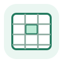
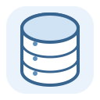
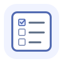

# Brightdesk product icon set

This folder contains the original Brightdesk product icon pack. Each icon is a separate, self-contained SVG with a consistent 128 × 128 view box, distinctive product imagery and an accessible title and description.

## Visual index

|  |  |  |  |  |
| --- | --- | --- | --- | --- |
|  **Pages** |  **Sheets** |  **Decks** |  **Notes** |  **Database** |
|  **Forms** |  **Lists** |  **Planner** |  **To Do** |  **Workspace** |

The visible product names provide each icon's label, so the preview images use empty alternative text to avoid repeating the same names to screen-reader users.

## Included icons

| File | Product | Visual concept |
| --- | --- | --- |
| `pages.svg` | Pages | Formal document page, heading and paragraphs |
| `sheets.svg` | Sheets | Spreadsheet grid, highlighted cell and chart |
| `decks.svg` | Decks | Presentation slide, chart and play marker |
| `notes.svg` | Notes | Sticky note and pencil |
| `database.svg` | Database | Structured record cylinder with stacked layers |
| `forms.svg` | Forms | Clipboard, question heading and response choices |
| `lists.svg` | Lists | Checklist with completed and open items |
| `planner.svg` | Planner | Calendar board with grouped task cards |
| `to-do.svg` | To Do | Daily task list with completed and remaining work |
| `workspace.svg` | Workspace | Desktop workspace with navigation and content blocks |

## Use and accessibility

- Use the icon as a supporting visual next to the product's visible text label.
- When the nearby text already names the product, use empty alternative text (`alt=""`) so assistive technology does not announce the same name twice.
- When the icon is used without a visible text label, provide meaningful alternative text such as `Brightdesk Pages`.
- Keep the SVG's `title` and `desc` elements when adapting an icon.
- Preserve the 128 × 128 view box, clear silhouette and readable contrast at small sizes.
- Do not recolour or combine icons in ways that confuse the product distinctions.

## Publication status

These are original source-library illustrations, not screenshots of the Brightdesk interface. Each icon also has a byte-for-byte copy in `docs/assets/images/product-icons/` for use by its matching customer guide. The public-output checker allows only these ten named SVGs and validates their structure, accessible title and description, static element and attribute allowlist, local use and alternative text. Keep the source copies canonical; regression tests detect any mismatch with the public copies.

No external images, font files, scripts, CSS imports or remote references are used.
