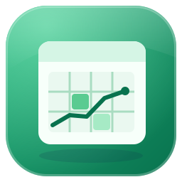

<section class="portal-hero" aria-labelledby="everyday-title">
  
EVERYDAY HELP

  <h1 id="everyday-title">Let's find what you need</h1>
  
You do not need technical knowledge. Choose the Brightdesk product you use, or tell us what you are trying to do and follow a simple guide.

  
<a href="../index.html">← Back to the Help home</a> · <a href="../technical/index.html">Want the detailed version? Open Technical Documentation →</a>

</section>
<section class="product-directory" aria-labelledby="everyday-suite-title">
  

THE SUITE AND ITS PRODUCTS
<h2 id="everyday-suite-title">Choose your Brightdesk product</h2>
Each guide uses plain language and shows you what to do, step by step.

  

    <a class="product-card product-card-suite" href="../customer-start-here.html">Brightdesk SuiteGet started and see how the products fit together</a>
    <a class="product-card" href="../products/pages.html">PagesDocuments and writing</a>
    <a class="product-card" href="../products/sheets.html">SheetsSpreadsheets and calculations</a>
    <a class="product-card" href="../products/decks.html">DecksSlide presentations</a>
    <a class="product-card" href="../products/notes.html">NotesNotes and ideas</a>
    <a class="product-card" href="../products/database.html">DatabaseStructured records</a>
    <a class="product-card" href="../products/forms.html">FormsForms and responses</a>
    <a class="product-card" href="../products/lists.html">ListsCustom lists and records</a>
    <a class="product-card" href="../products/planner.html">PlannerProjects and planning</a>
    <a class="product-card" href="../products/to-do.html">To DoPersonal tasks</a>
    <a class="product-card" href="../products/workspace.html">WorkspaceProject information together</a>
  

</section>
<section class="product-directory" aria-labelledby="task-directory-title">
  

START WITH YOUR TASK
<h2 id="task-directory-title">What are you trying to do?</h2>
Choose the closest match. You can always switch products later.

  <ul class="task-grid">
    <li><a href="../products/pages.html">Write a letter, report or document</a>Pages</li>
    <li><a href="../products/sheets.html">Add up numbers or make a budget</a>Sheets</li>
    <li><a href="../products/decks.html">Make a presentation</a>Decks</li>
    <li><a href="../products/notes.html">Write down an idea or reminder</a>Notes</li>
    <li><a href="../products/database.html">Keep information in an organised table</a>Database</li>
    <li><a href="../products/forms.html">Create a form or survey</a>Forms</li>
    <li><a href="../products/lists.html">Organise items or records</a>Lists</li>
    <li><a href="../products/planner.html">Plan a project and its tasks</a>Planner</li>
    <li><a href="../products/to-do.html">Keep track of things you need to do</a>To Do</li>
    <li><a href="../products/workspace.html">Bring project notes and information together</a>Workspace</li>
  </ul>
</section>
