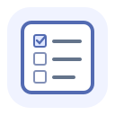

<section class="home-hero" aria-labelledby="home-title">
  

    
BRIGHTDESK HELP CENTRE

    <h1 id="home-title">Find your way through Brightdesk.</h1>
    
Practical answers, clear instructions and useful product guides — all in one place.

  

  

    <label id="help-search-label" for="help-search">What do you need help with?</label>
    <input id="help-search" type="search" autocomplete="off"
      placeholder="Search a task or product"
      aria-describedby="help-search-hint help-search-status" aria-controls="help-search-results">
    
Search Everyday Help, the Suite guide and all ten product guides. Your search stays in this browser.

    
Type a word or task to find a guide.

    <ul id="help-search-results" class="search-results" aria-label="Matching help guides" hidden></ul>
  

  <nav class="home-pathways" aria-label="Choose a help area">
    <a class="home-pathway" href="everyday/index.html">
      PLAIN-ENGLISH GUIDANCE
      <strong>Everyday Help</strong>
      Step-by-step instructions for everyday tasks, setup and common questions.
      Explore Everyday Help →
    </a>
    <a class="home-pathway" href="technical/index.html">
      DETAILED REFERENCE
      <strong>Technical Documentation</strong>
      Product references, file formats, system behaviour and data boundaries.
      Explore technical references →
    </a>
  </nav>
</section>

<section class="home-suite-start" aria-labelledby="suite-start-title">
  

    
NEW TO BRIGHTDESK?

    <h2 id="suite-start-title">Start with Brightdesk Suite</h2>
    
See how the Suite fits together and find the right place to begin.

  

  <a href="customer-start-here.html">Open the Suite guide →</a>
</section>

<section class="home-directory" aria-labelledby="directory-title">
  

    

      
THE BRIGHTDESK PRODUCTS

      <h2 id="directory-title">Find help by what you are working on</h2>
      
Ten products, organised around three familiar kinds of work.

    

    10 CUSTOMER PRODUCTS
  

  

    <section class="home-group home-group-create" aria-labelledby="group-create-title">
      
01 CREATE

      <h3 id="group-create-title">Create and communicate</h3>
      
Write, present and capture ideas.

      <ul>
        <li><a class="home-product-link" href="products/pages.html"><strong>Pages</strong><small>Documents and writing</small>→</a></li>
        <li><a class="home-product-link" href="products/decks.html"><strong>Decks</strong><small>Slide presentations</small>→</a></li>
        <li><a class="home-product-link" href="products/notes.html"><strong>Notes</strong><small>Notes and ideas</small>→</a></li>
      </ul>
    </section>

    <section class="home-group home-group-information" aria-labelledby="group-information-title">
      
02 INFORMATION

      <h3 id="group-information-title">Work with information</h3>
      
Calculate, collect and organise records.

      <ul>
        <li><a class="home-product-link" href="products/sheets.html"><strong>Sheets</strong><small>Spreadsheets and calculations</small>→</a></li>
        <li><a class="home-product-link" href="products/database.html"><strong>Database</strong><small>Structured records and tables</small>→</a></li>
        <li><a class="home-product-link" href="products/forms.html"><strong>Forms</strong><small>Forms and responses</small>→</a></li>
        <li><a class="home-product-link" href="products/lists.html"><strong>Lists</strong><small>Custom lists and records</small>→</a></li>
      </ul>
    </section>

    <section class="home-group home-group-plan" aria-labelledby="group-plan-title">
      
03 ORGANISE

      <h3 id="group-plan-title">Plan and organise</h3>
      
Keep projects and tasks in order.

      <ul>
        <li><a class="home-product-link" href="products/planner.html"><strong>Planner</strong><small>Projects and planning boards</small>→</a></li>
        <li><a class="home-product-link" href="products/to-do.html"><strong>To Do</strong><small>Personal tasks and due dates</small>→</a></li>
        <li><a class="home-product-link" href="products/workspace.html"><strong>Workspace</strong><small>Project information together</small>→</a></li>
      </ul>
    </section>
  

</section>

<section class="home-guides" aria-labelledby="guides-title">
  

    
COMMON HELP TOPICS

    <h2 id="guides-title">A good place to start</h2>
    
Open a focused guide for common setup and support questions.

  

  

    <a href="everyday/install-update.html">01<strong>Install and update</strong><small>Installation, product workspaces and updates</small>→</a>
    <a href="everyday/languages-and-spelling.html">02<strong>Languages and spelling</strong><small>Display language, proofing and dictionaries</small>→</a>
    <a href="everyday/troubleshooting.html">03<strong>Troubleshooting</strong><small>Find safe next steps for common issues</small>→</a>
    <a href="products/decks-slide-shows.html">04<strong>Decks slide shows</strong><small>Start a slide show and move through a presentation</small>→</a>
  

</section>

<section class="home-reassurance" aria-labelledby="reassurance-title">
  

    
BUILT AROUND YOUR WORK

    <h2 id="reassurance-title">Clear help. No extra hurdles.</h2>
  

  

    
Brightdesk Help is free to read, static and read-only. You do not need an account, and you never need to upload your documents here.

    
It supports Brightdesk desktop software for Windows, macOS and Linux. Search stays in your browser, and you can move between everyday instructions and deeper technical references at any time.

  

</section>
