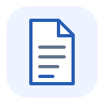
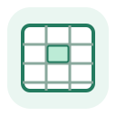
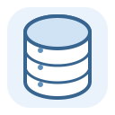
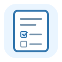
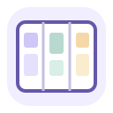
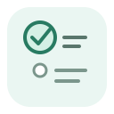

<section class="portal-hero" aria-labelledby="portal-title">
  
BRIGHTDESK SUPPORT

  <h1 id="portal-title">What would you like help with?</h1>
  
Choose the kind of information you want. Both areas are part of one Brightdesk Help website, and you can switch between them at any time.

  

    <a class="portal-choice portal-choice-everyday" href="everyday/index.html">
      B
      
        A SIMPLE PLACE TO START
        <strong>Everyday Help</strong>
        Plain-English instructions, step-by-step guides, examples and help with common tasks. No technical knowledge needed.
        Go to Everyday Help →
      
    </a>
    <a class="portal-choice portal-choice-technical" href="technical/index.html">
      ⌘
      
        FOR DEEPER READING
        <strong>Technical Documentation</strong>
        Detailed product references, capabilities, file formats, system behaviour and data boundaries.
        Go to Technical Documentation →
      
    </a>
  

</section>

<section class="product-directory" aria-labelledby="product-directory-title">
  

    

      
THE BRIGHTDESK SUITE

      <h2 id="product-directory-title">Find the product you use</h2>
      
Choose a product to open its help guide. Not sure where to begin? Start with the Suite guide.

    

    <a class="suite-guide-link" href="customer-start-here.html">Explore Brightdesk Suite →</a>
  

  

    <a class="product-card product-card-suite" href="customer-start-here.html">
      B
      Brightdesk Suite
      How the Suite fits together and where to start
    </a>
    <a class="product-card" href="products/pages.html">PagesDocuments and writing</a>
    <a class="product-card" href="products/sheets.html">SheetsSpreadsheets and calculations</a>
    <a class="product-card" href="products/decks.html">DecksSlide presentations</a>
    <a class="product-card" href="products/notes.html">NotesNotes and ideas</a>
    <a class="product-card" href="products/database.html">DatabaseStructured records</a>
    <a class="product-card" href="products/forms.html">FormsForms and responses</a>
    <a class="product-card" href="products/lists.html">ListsCustom lists and records</a>
    <a class="product-card" href="products/planner.html">PlannerProjects and planning</a>
    <a class="product-card" href="products/to-do.html">To DoPersonal tasks</a>
    <a class="product-card" href="products/workspace.html">WorkspaceProject information together</a>
  

</section>

<section class="reference-section" aria-labelledby="popular-guides-title">
  

MORE WAYS TO GET HELP
<h2 id="popular-guides-title">Choose a guide by what you need</h2>
The homepage search above remains available. You can also open a focused guide directly.

  

    <a class="reference-card" href="everyday/install-update.html"><strong>Install and update</strong>Official Suite installation, product workspaces and current update status.Open guide →</a>
    <a class="reference-card" href="everyday/languages-and-spelling.html"><strong>Languages and spelling</strong>Display language, proofing language and official dictionary packs.Open guide →</a>
    <a class="reference-card" href="everyday/troubleshooting.html"><strong>Troubleshooting</strong>Find a product's common questions and safe next steps.Open guide →</a>
    <a class="reference-card" href="products/decks-slide-shows.html"><strong>Decks slide shows</strong>Start from the right slide and move through a presentation.Open guide →</a>
  

</section>

<section class="portal-note" aria-label="About Brightdesk Help">
  <strong>One website. Two ways to explore.</strong>
  
Everyday Help and Technical Documentation have separate navigation and separate search results. Search stays in your browser. This site is read-only and does not require an account.

  
<strong>Desktop software only:</strong> Brightdesk Suite and all ten products are available for Windows, macOS and Linux. There are no mobile applications or mobile product versions.

</section>

**Brightdesk Suite and all ten approved products are free.** There are no subscriptions, trials, paid tiers, licence fees or customer accounts.
