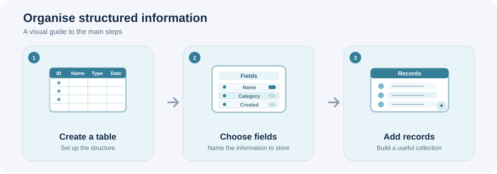

# Brightdesk Database

{: .product-guide-icon }

  

*Illustrative workflow, not a screenshot of the Brightdesk interface.*

## Overview

Use Database to keep structured information in tables with named fields.

<nav class="guide-contents" aria-label="Sections in this guide">
  <a href="#overview">Overview</a> · <a href="#getting-started">Getting started</a> · <a href="#workflows">Workflows</a> · <a href="#troubleshooting-and-common-questions">Troubleshooting</a>
</nav>

## Getting started

### Create a table

1. Open Brightdesk Database. A new database starts with **Table1**.
2. Under **Tables**, enter a name in **New table name**.
3. Choose **Create table**.
4. Select a table in the left-hand list to work with it.

## Workflows

### Add fields

1. Expand **Manage fields**.
2. Under **Add a field**, enter a **Field name**.
3. Choose a **Field type**: Text, Number, Date, Email, Web address, Checkbox or Choice list.
4. For a Choice list field, enter the available choices separated by commas.
5. Select **Required field** when every record must have a value.
6. Choose **Add field**.

Your new field appears as a column in the table. The system ID field is managed by Database.

### Remove a field

1. Expand **Manage fields**.
2. Find the field you want to remove.
3. Choose **Remove** next to that field.
4. Read the confirmation, which says the field and its values will be removed from every record.
5. Export a CSV copy first when you need to keep those values.

The system ID field is protected and cannot be removed.

### Add and update records

1. Open the **Add a record** section.
2. Complete the fields shown for the selected table.
3. Choose **Add record**.
4. To update a value later, edit it directly in the table. The change is saved on this device.
5. Choose **Delete** on a record only when you intend to remove it.

### Find and sort records

- Enter words in **Search records** to find matching values.
- Choose a field in **Sort by** to choose the column. Choose **Ascending** or **Descending** under **Order** to set the direction.

### Rename, delete or export a table

- Choose **Rename table** to change the selected table's name.
- Choose **Delete table** only when you intend to remove that table and its records. Database must keep at least one table.
- Choose **Export CSV** to export the current table.

### Try this example: create a contacts table

1. Create a table called **Contacts**.
2. Add a field named **Name** and choose **Text**.
3. Add a field named **Email** and choose **Email**.
4. Add a field named **Follow-up needed** and choose **Checkbox**.
5. Add one practice record using made-up contact details.
6. Enter the name in **Search records** to find the record.

**What you should have:** a local Contacts table with three useful fields and a searchable sample record. Use fictional details while practising.
### More examples to try

#### Track household equipment

1. Create a table called **Household equipment**.
2. Add a **Name** field with type **Text**.
3. Add a **Category** field with type **Choice**, then enter choices separated by commas.
4. Add a **Purchase date** field with type **Date**.
5. Add a **Needs repair** field with type **Checkbox**.
6. Add a few sample records and use **Search records** to find one.

**What you should have:** a table with named fields that describe each item.

#### Keep an event contact list

1. Create a table called **Event contacts**.
2. Add **Name** as a **Text** field and **Email address** as an **Email** field.
3. Add a **Contacted** field as a **Checkbox**.
4. Add sample records using fictional contact details.
5. Search for a name, then choose **Export CSV** when you need a copy of the current table.

**What you should have:** a searchable local contact table and a CSV export. Use fictional details while practising.

## Troubleshooting and common questions

**Why can't I add another table after deleting one?** Database must keep at least one table.

**What happens if I delete a table?** The table and its records are removed. Export a CSV copy first when you need to keep the records elsewhere.

**How do I create a drop-down choice field?** Add a field with type **Choice list** and enter the options separated by commas.

**What happens if I remove a field?** The field and its values are removed from every record in the table. Export a CSV copy first if you need to keep those values. The system ID field cannot be removed.

## Current feature boundaries

Database is a local table-and-record tool. SQL query execution, table relationships, a query designer, form and report designers, database import, online hosting and collaboration are not included in the current stated scope.

## Guide status

**Needs review.** These steps are based on the current Database interface and source. They still need to be run from start to finish in a current installed desktop build before the guide can be approved for customers.
