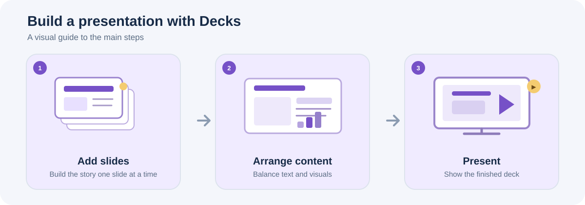

# Brightdesk Decks

{: .product-guide-icon }

{: .product-workflow-diagram }

*Illustrative workflow, not a screenshot of the Brightdesk interface.*

Use Decks to build and present a slide presentation.

## Edit the first slide

1. Open Brightdesk Decks. A new presentation starts with a slide.
2. Select the slide title area and enter your title.
3. Select the slide text area and enter your main points.
4. Your edits are saved on this device as you work.

## Add and organise slides

1. Open **Home**.
2. Choose **New slide** to add a slide.
3. Choose **Duplicate** to make a copy of the current slide.
4. Choose **Delete** to remove the current slide. A presentation must keep at least one slide.
5. Use **Previous** and **Next** below the slide to move through the presentation.

You can also open **Insert** and choose **Title slide** or **Text slide** to add a slide with starter content.

## Choose a theme

1. Open **Design**.
2. Choose **Lavender**, **Midnight** or **Paper**.
3. Continue editing the slide content in the presentation workspace.

## Present your slides

1. Select the slide where you want to begin.
2. Open **Slide Show**.
3. Choose **From current slide**.
4. During the presentation, click or use the arrow keys to move between slides.
5. Press **Esc** to leave presentation mode.

## Open, save and export

- Choose **Save project** to save Brightdesk project data.
- Choose **Open** to open supported presentation data.
- Choose **Export** to see the output formats available in your installed version.

The product documentation describes PowerPoint import and export. Check the presentation after transferring it, because some advanced PowerPoint objects and formatting may not be preserved.

## Current feature boundaries

Decks provides a core slide-editing and presenting workflow. Advanced layouts, transitions, embedded media, animation and complete PowerPoint round-trip fidelity are not promised.

## Guide status

**Needs review.** These steps are based on the current Decks interface and product documentation. They still need to be run from start to finish in a current installed desktop build before the guide can be approved for customers.

[Back to Brightdesk Help](../index.html)
