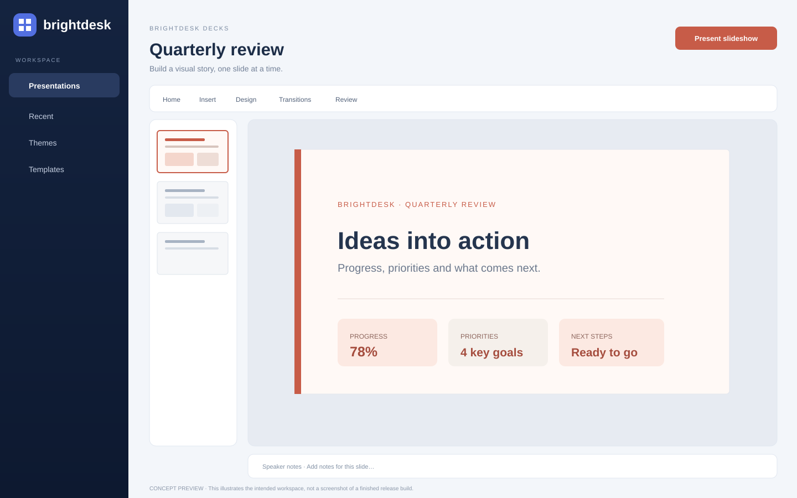

# Brightdesk Decks

<figure class="product-preview">
  
  <figcaption>Design preview only — not a screenshot of the current running product. The actual interface and available controls must be checked against the installed release.</figcaption>
</figure>

## Overview

Use Decks to build and present a slide presentation.

<figure class="guide-illustration">
  
  <figcaption>Illustrative workflow map only. It explains the task sequence; it is not a screenshot of the Brightdesk interface.</figcaption>
</figure>
<nav class="guide-contents" aria-label="Sections in this guide">
  <a href="#overview">Overview</a> · <a href="#getting-started">Getting started</a> · <a href="#workflows">Workflows</a> · <a href="#troubleshooting-and-common-questions">Troubleshooting</a>
</nav>

## Getting started

### Edit the first slide

1. Open Brightdesk Decks. A new presentation starts with a slide.
2. Select the slide title area and enter your title.
3. Select the slide text area and enter your main points.
4. Your edits are saved on this device as you work.

## Workflows

### Add and organise slides

1. Open **Home**.
2. Choose **New slide** to add a slide.
3. Choose **Duplicate** to make a copy of the current slide.
4. Choose **Delete** to remove the current slide. A presentation must keep at least one slide.
5. Use **Previous** and **Next** below the slide to move through the presentation.

You can also open **Insert** and choose **Title slide** or **Text slide** to add a slide with starter content.

### Choose a theme

1. Open **Design**.
2. Choose **Lavender**, **Midnight** or **Paper**.
3. Continue editing the slide content in the presentation workspace.

### Present your slides

1. Select the slide where you want to begin.
2. Open **Slide Show**.
3. Choose **From current slide**.
4. During the presentation, click or use the arrow keys to move between slides.
5. Press **Esc** to leave presentation mode.

### Open, save and export

- Choose **Save project** to save Brightdesk project data.
- Choose **Open** to open supported presentation data.
- Choose **Export** to see the output formats available in your installed version.

The product documentation describes PowerPoint import and export. Check the presentation after transferring it, because some advanced PowerPoint objects and formatting may not be preserved.

### Try this example: make a three-slide presentation

1. On the first slide, enter **My project** as the title.
2. Choose **Home → New slide** to add a second slide. Add two short project points.
3. Add a third slide and enter the next steps.
4. Open **Design** and choose **Lavender**, **Midnight** or **Paper**.
5. Open **Slide Show → From current slide** on the first slide.

**What you should have:** a simple three-slide presentation that you can move through with the arrow keys.
### More examples to try

#### Give a project update

1. Open a new presentation and enter **Project update** as the title on the first slide.
2. Choose **Home → New slide** and list what has been completed.
3. Add another slide for the next steps.
4. Open **Design** and choose **Lavender**, **Midnight** or **Paper**.
5. Select the first slide, then choose **Slide Show → From current slide**.

**What you should have:** a short update that moves from the project title to completed work and next steps.

#### Reuse a slide layout

1. Create a slide with a title and a few points.
2. Choose **Home → Duplicate**.
3. Change the title and text on the copy.
4. Repeat when you need another slide with a similar structure.
5. Use **Previous** and **Next** below the slide to review the order.

**What you should have:** several slides with a consistent starting layout. Check each copy so it contains the right information.

## Troubleshooting and common questions

**How do I start presenting from a particular slide?** Select that slide first, then choose **Slide Show → From current slide**.

**How do I leave presentation mode?** Press **Esc**.

**Will every PowerPoint effect look the same?** No. Advanced objects and formatting may not be preserved when transferring a presentation. Review the slides after opening or exporting a file.

## Current feature boundaries

Decks provides a core slide-editing and presenting workflow. Advanced layouts, transitions, embedded media, animation and complete PowerPoint round-trip fidelity are not promised.

## Guide status

**Needs review.** These steps are based on the current Decks interface and product documentation. They still need to be run from start to finish in a current installed desktop build before the guide can be approved for customers.

## Need the technical detail?

For product behaviour, file handling and technical boundaries, see the [Brightdesk Decks technical reference](../technical/products/decks.html).

[Back to Brightdesk Help](../index.html)
