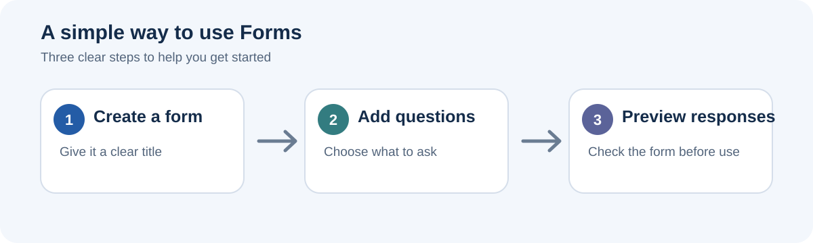

# Brightdesk Forms

Use Forms to create local forms, surveys and quizzes, then review the responses saved on your device.

<figure class="guide-illustration">
  
  <figcaption>Illustrative workflow map only. It explains the task sequence; it is not a screenshot of the Brightdesk interface.</figcaption>
</figure>

## Create a form

1. Under **Your forms**, enter a name in **New form name**.
2. Choose **Create form**.
3. Select the new form in the left-hand list.

## Set the form title and description

1. Open the **Questions** tab.
2. Enter a **Form title**.
3. Add a **Description** if it will help explain the form.
4. Choose **Save form details**.

## Add questions

1. Under **Add a question**, enter the question text.
2. Choose a question type: **Short answer**, **Long answer**, **Single choice**, **Multiple choice** or **Date**.
3. For a choice question, enter the available choices separated by commas.
4. Select **Required question** when an answer must be provided.
5. Choose **Add question**.

To change an existing question, edit it in the question list and choose **Save question**. Deleting a question also removes that question's answer from every saved response. It does not delete the whole response, but the removed answers cannot be recovered from that form.

## Preview and collect a response

1. Open the **Preview** tab.
2. Complete the form as a respondent would.
3. Choose **Submit response**.
4. The response is saved on this device.

## Review responses

1. Open the **Responses** tab.
2. Read the saved answers.
3. Choose **Delete response** only when you intend to remove a response.

## Try this example: make a short feedback form

1. Create a form called **Product feedback**.
2. Open **Questions** and set the form title to **Tell us what you think**.
3. Add a **Short answer** question: **What did you use today?**
4. Add a **Single choice** question with choices **Easy**, **Okay** and **Difficult**.
5. Open **Preview**, enter sample answers and choose **Submit response**.
6. Open **Responses** to see the saved sample response.

**What you should have:** a two-question form and one response saved on this device. The form is not published online.
## More examples to try

### Create a simple event feedback form

1. Create a form called **Event feedback**.
2. Open **Questions** and set the form title to **How was the event?**
3. Add a **Single choice** question with choices such as **Good**, **Okay** and **Needs improvement**.
4. Add a **Long answer** question asking what could be improved.
5. Open **Preview**, enter sample answers and choose **Submit response**.
6. Open **Responses** to review the saved response.

**What you should have:** a two-question feedback form and a response saved on this device.

### Ask for a preferred date

1. Create a form called **Preferred meeting date**.
2. Add a **Short answer** question asking for the person's name.
3. Add a **Date** question asking for a preferred date.
4. Open **Preview** and submit a practice response.
5. Open **Responses** to check what was saved.

**What you should have:** a small local form with a name field and a date question. It is not published online or sent to other people.

## Common questions and fixes

**Can I send someone a public link to fill in this form?** No. The current Forms workflow saves responses on this device; online publishing and public response links are not included.

**What happens if I delete a question?** That question's answer is removed from every saved response for that form and cannot be recovered from the form. Review the impact before deleting a question.

**Where do I find a submitted practice response?** Open the form's **Responses** tab.

## Current feature boundaries

Forms collects responses locally on the device. Online publishing, public response links, branching logic, scoring, file attachments, cloud response collection and collaboration are not included in the current stated scope.

## Guide status

**Needs review.** These steps are based on the current Forms interface and source. They still need to be run from start to finish in a current installed desktop build before the guide can be approved for customers.

## Need the technical detail?

For product behaviour, file handling and technical boundaries, see the [Brightdesk Forms technical reference](../technical/products/forms.html).

[Back to Brightdesk Help](../index.html)
