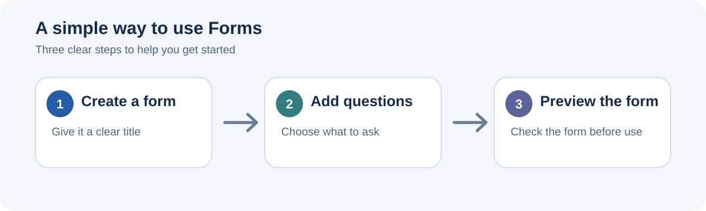

# Brightdesk Forms

{: .product-guide-icon }

  

*Illustrative workflow, not a screenshot of the Brightdesk interface.*

Use Forms to create local forms, surveys and quizzes, then review the responses saved on your device.

## Create a form

1. Under **Your forms**, enter a name in **New form name**.
2. Choose **Create form**.
3. Select the new form in the left-hand list.

## Set the form title and description

1. Open the **Questions** tab.
2. Enter a **Form title**.
3. Add a **Description** if it will help explain the form.
4. Choose **Save form details**.

## Add questions

1. Under **Add a question**, enter the question text.
2. Choose a question type: **Short answer**, **Long answer**, **Single choice**, **Multiple choice** or **Date**.
3. For a choice question, enter the available choices separated by commas.
4. Select **Required** when an answer must be provided.
5. Choose **Add question**.

To change an existing question, edit it in the question list and choose **Save question**. Deleting a question also removes that question's answer from every saved response. It does not delete the whole response, but the removed answers cannot be recovered from that form.

## Preview and collect a response

1. Open the **Preview** tab.
2. Complete the form as a respondent would.
3. Choose **Submit response**.
4. The response is saved on this device.

## Review responses

1. Open the **Responses** tab.
2. Read the saved answers.
3. Choose **Delete response** only when you intend to remove a response.

## Current feature boundaries

Forms collects responses locally on the device. Online publishing, public response links, branching logic, scoring, file attachments, cloud response collection and collaboration are not included in the current stated scope.

## Guide status

**Needs review.** These steps are based on the current Forms interface and source. They still need to be run from start to finish in a current installed desktop build before the guide can be approved for customers.

[Back to Brightdesk Help](../index.html)
