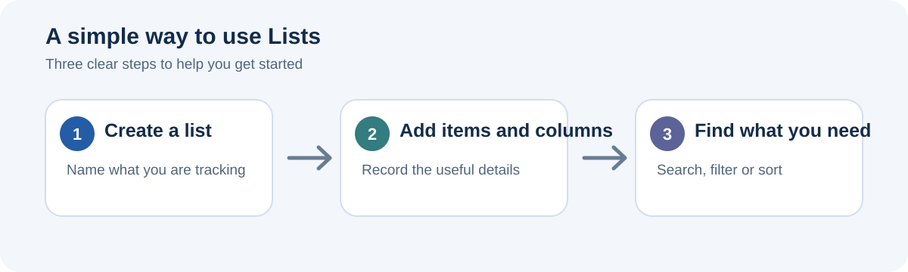

# Brightdesk Lists

## Overview

Use Lists to organise projects, stock, contacts or other information as structured records.

<figure class="guide-illustration">
  
  <figcaption>Illustrative workflow map only. It explains the task sequence; it is not a screenshot of the Brightdesk interface.</figcaption>
</figure>
<nav class="guide-contents" aria-label="Sections in this guide">
  <a href="#getting-started">Getting started</a> · <a href="#workflows">Workflows</a> · <a href="#troubleshooting-and-common-questions">Troubleshooting</a>
</nav>

## Getting started

### Create a list

1. Under **Your lists**, enter a name in **New list name**.
2. Add a description if you need one.
3. Choose **Create list**.
4. Select your list in the left-hand panel.

A new list starts with the columns **Title**, **Status**, **Priority**, **Due date** and **Notes**.

## Workflows

### Add or edit a record

1. Open your list.
2. Choose **Add record**.
3. Complete the fields shown.
4. Choose **Add record** to save the record.
5. To change an existing record, choose **Edit**, make your changes and choose **Save changes**.
6. Choose **Delete** only when you intend to remove a record.

### Add a custom column

1. Under the list, enter a name in **New column name**.
2. Choose **Text**, **Date** or **Choice** as the column type.
3. For a Choice column, enter the options in the comma-separated options field.
4. Choose **Add column**.

### Search, filter and sort

- Enter a word in **Search this list** to find matching records.
- Use **Filter by status** to choose **All records**, **Active** (Not started and In progress) or **Done**. The Active option shows both unfinished statuses; Done shows completed records.
- Choose a field in **Sort by column**.
- Choose **Ascending** or **Descending** under **Sort direction**, then choose **Sort**.

### Rename or delete a list

Choose **Rename** to change the list name. Choose **Delete list** only when you intend to remove the list and all its records.

### Save your work

Lists are saved on this device as you work. Check the local-save status in the workspace.

### Try this example: organise a reading list

1. Create a list called **Books to read**.
2. Choose **Add record** and enter a book title.
3. Expand **Add a custom column**.
4. Name the column **Genre**, choose **Choice**, and enter a few options separated by commas.
5. Edit the book record and choose its genre.
6. Use **Search this list** to find the title.

**What you should have:** a local reading list with a custom Genre column that you can search and sort.
### More examples to try

#### Organise a home inventory

1. Create a list called **Home inventory**.
2. Add a record for an item.
3. Expand **Add a custom column** and add **Room** as a **Choice** column.
4. Enter room names separated by commas.
5. Edit the item and choose its room.
6. Use **Search this list** to find an item.

**What you should have:** a local inventory list with a custom room column.

#### Track follow-up items

1. Create a list called **Follow-ups**.
2. Add a record for each item that needs attention.
3. Use the default **Status**, **Priority** and **Due date** fields to organise each record.
4. Use **Filter by status** to show items with the status you need.
5. Sort by a useful column when you want to change the order.

**What you should have:** a list of follow-up items that you can search, filter and sort.

## Troubleshooting and common questions

**Which custom column types can I add?** The current guide lists **Text**, **Date** and **Choice**.

**How do I show only certain records?** Use **Filter by status**. Use **Search this list** when you need to find a word or title.

**What happens if I delete a list?** The list and all its records are removed. Make sure you intend to remove the records before choosing **Delete list**.

## Current feature boundaries

Lists is a local structured-list tool. Shared editing, user permissions, attachments, automation, connected data sources and online forms are not included in the current stated scope.

## Guide status

**Needs review.** These steps are based on the current Lists interface and source. They still need to be run from start to finish in a current installed desktop build before the guide can be approved for customers.

## Need the technical detail?

For product behaviour, file handling and technical boundaries, see the [Brightdesk Lists technical reference](../technical/products/lists.html).

[Back to Brightdesk Help](../index.html)
