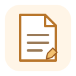

# Brightdesk Notes

{: .product-guide-icon }

Use Notes to capture quick thoughts, reminders and short pieces of information.

## Write a note

1. Open Brightdesk Notes. A new note starts with the title **Untitled note**.
2. Select the title field and enter a name for the note.
3. Click in the notes writing area and type.
4. Your note text is saved on this device as you work.

## Add a date or simple checklist marker

1. Place the cursor in the note where you want the item.
2. Open **Insert**.
3. Choose **Date** to insert the current date.
4. Choose **Divider** to add a visual separator.
5. Choose **Checklist item** to insert an unchecked box marker.

These insertions add text to the note; they are not a separate task-management list.

## Export or clear a note

1. Open **Home**.
2. Choose **Export note** to export the current note.
3. Choose the format offered by the export control. The product documentation lists Markdown and plain text.
4. Choose **Clear note** only when you intend to remove the current note text, then confirm the prompt.

## Language and spelling

Use the shared Brightdesk language and spelling tools where they are available in your installed version. The languages and dictionaries offered depend on what is installed and verified on your device.

## Current feature boundaries

The current Notes workflow is a quick-note editor. Notebook hierarchies, sections, linked pages, attachments and collaborative notebooks are not described as finished features.

## Guide status

**Needs review.** These steps are based on the current Notes interface and product documentation. They still need to be run from start to finish in a current installed desktop build before the guide can be approved for customers.

[Back to Brightdesk Help](../index.html)
