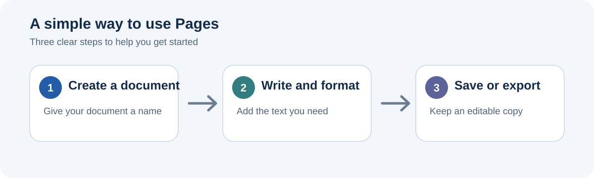

# Brightdesk Pages

## Overview

Use Pages to write letters, reports and other text documents.

<figure class="guide-illustration">
  
  <figcaption>Illustrative workflow map only. It explains the task sequence; it is not a screenshot of the Brightdesk interface.</figcaption>
</figure>
<nav class="guide-contents" aria-label="Sections in this guide">
  <a href="#getting-started">Getting started</a> · <a href="#workflows">Workflows</a> · <a href="#troubleshooting-and-common-questions">Troubleshooting</a>
</nav>

## Getting started

### Create a document

1. Open Brightdesk Pages. A new document opens in the writing workspace.
2. Select the title field, which starts as **Untitled document**, and enter a name.
3. Click in the document writing area and start typing.
4. Your edits are saved locally as you work. Check the status at the top of the workspace.

## Workflows

### Format your writing

1. Select the text you want to format.
2. Open the **Home** tab.
3. Choose **Bold**, **Italic** or **Underline**.
4. Choose **Heading 1** or **Heading 2** to create a heading.
5. Use **Bullets**, **Numbering** or **Quote** to format paragraphs.
6. Use **Undo** or **Redo** when you need to step backwards or forwards through an edit.

### Insert content

Open **Insert** and choose one of the available options:

- **Table 2 × 2** to insert a small table.
- **Horizontal line** to separate sections.
- **Date** to insert the current date at the cursor.

### Set up the page

1. Open **Layout**.
2. Under **Page setup**, choose a **Paper** size: A4, US Letter or US Legal.
3. Choose **Orientation**: Portrait or Landscape.
4. Choose a **Margins** preset: Normal, Narrow, Moderate or Wide.

### Review and view your document

- Open **Review** and choose **Word count** to see the number of words.
- Use **Spell check** to switch the editor's spell-check setting on or off.
- Open **View** to change the zoom or switch **Focus mode** on or off.

### Save and export your document

- Choose **Save project** to save Brightdesk project data.
- Choose **Open** to open supported existing project or document data.
- Choose **Export** in the top bar to see the document formats available in your installed version.
- To create a PDF copy, open **Home** and choose **PDF** in the **Export** group.

### Try this example: write a meeting note

1. Give the document the name **Team meeting notes**.
2. Add a **Heading 1** called **Topics**.
3. Write three bullet points for the things you want to discuss.
4. Bold the most important action.
5. Choose **Save project** to keep the editable Brightdesk project.

**What you should have:** a short meeting document with a clear heading, bullet points and one highlighted action.
### More examples to try

#### Write a formal letter

1. Create a document and give it a clear name, such as **Letter to the landlord**.
2. Type the date, greeting, main message and sign-off in the writing area.
3. Select the letter's heading or important sentence and use **Bold** if it helps the reader.
4. Open **Layout** and choose **A4**, **Portrait** and a margin preset.
5. Choose **Save project** to keep an editable Brightdesk copy.
6. To make a PDF copy, choose **Home → PDF** in the **Export** group.

**What you should have:** a named letter with a page size and a saved editable copy. The PDF is a separate copy.

#### Prepare a short report

1. Create a document called **Monthly progress report**.
2. Add a **Heading 1** for the report title.
3. Use **Heading 2** for sections such as **Completed**, **In progress** and **Next steps**.
4. Use bullet points under each section.
5. Open **Review → Word count** to check the length.
6. Save the project. Choose **Home → PDF** when you need a shareable PDF copy.

**What you should have:** a report with clear sections, a word count and an editable project copy.

## Troubleshooting and common questions

**How do I make a PDF?** Choose **Home**, then **PDF** in the **Export** group. The general **Export** menu may offer other formats.

**How do I keep editing later?** Choose **Save project** and keep the Brightdesk project file. A PDF is a separate output copy, not the editable project.

**Why did formatting change?** Select the text first, then apply the formatting command. Imported documents may not preserve every advanced layout feature.

## Current feature boundaries

Pages provides core document writing, formatting and page setup. It is not full word-processor feature parity. Advanced page-layout tools, macros, collaboration and perfect round-trip conversion are not promised.

## Guide status

**Needs review.** These steps are based on the current Pages interface and source. They still need to be run from start to finish in a current installed desktop build before the guide can be approved for customers.

## Need the technical detail?

For product behaviour, file handling and technical boundaries, see the [Brightdesk Pages technical reference](../technical/products/pages.html).

[Back to Brightdesk Help](../index.html)
