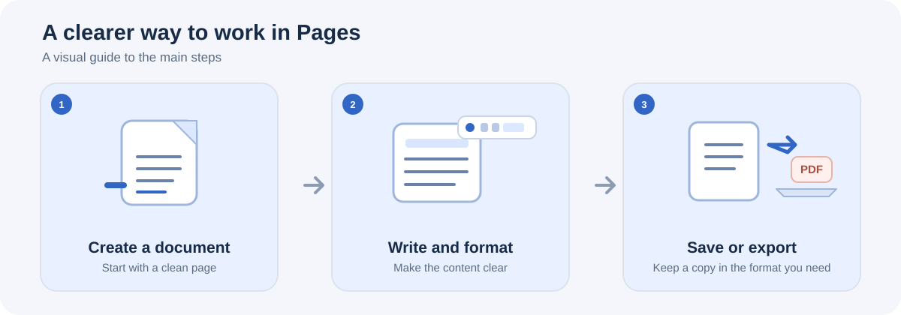

# Brightdesk Pages

{: .product-guide-icon }

{: .product-workflow-diagram }

*Illustrative workflow, not a screenshot of the Brightdesk interface.*

Use Pages to write letters, reports and other text documents.

## Create a document

1. Open Brightdesk Pages. A new document opens in the writing workspace.
2. Select the title field, which starts as **Untitled document**, and enter a name.
3. Click in the document writing area and start typing.
4. Your edits are saved locally as you work. Check the status at the top of the workspace.

## Format your writing

1. Select the text you want to format.
2. Open the **Home** tab.
3. Choose **Bold**, **Italic** or **Underline**.
4. Choose **Heading 1** or **Heading 2** to create a heading.
5. Use **Bullets**, **Numbering** or **Quote** to format paragraphs.
6. Use **Undo** or **Redo** when you need to step backwards or forwards through an edit.

## Insert content

Open **Insert** and choose one of the available options:

- **Table 2 × 2** to insert a small table.
- **Horizontal line** to separate sections.
- **Date** to insert the current date at the cursor.

## Set up the page

1. Open **Layout**.
2. Under **Page setup**, choose a **Paper** size: A4, US Letter or US Legal.
3. Choose **Orientation**: Portrait or Landscape.
4. Choose a **Margins** preset: Normal, Narrow, Moderate or Wide.

## Review and view your document

- Open **Review** and choose **Word count** to see the number of words.
- Use **Spell check** to switch the editor's spell-check setting on or off.
- Open **View** to change the zoom or switch **Focus mode** on or off.

## Save and export your document

- Choose **Save project** to save Brightdesk project data.
- Choose **Open** to open supported existing project or document data.
- Choose **Export** in the top bar to see the document formats available in your installed version.
- To create a PDF copy, open **Home** and choose **PDF** in the **Export** group.

## Current feature boundaries

Pages provides core document writing, formatting and page setup. It is not full word-processor feature parity. Advanced page-layout tools, macros, collaboration and perfect round-trip conversion are not promised.

## Guide status

**Needs review.** These steps are based on the current Pages interface and source. They still need to be run from start to finish in a current installed desktop build before the guide can be approved for customers.

[Back to Brightdesk Help](../index.html)
