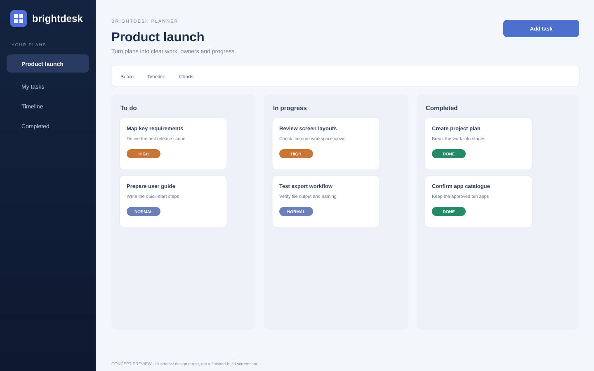
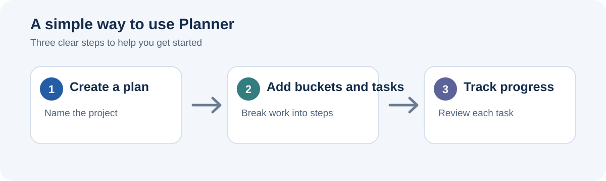

# Brightdesk Planner

## Overview

Use Planner to organise a project into a plan, buckets and tasks.

<figure class="product-preview">
  
  <figcaption>Design preview only — not a screenshot of the current running product. The actual interface and available controls must be checked against the installed release.</figcaption>
</figure>

<figure class="guide-illustration">
  
  <figcaption>Illustrative workflow map only. It explains the task sequence; it is not a screenshot of the Brightdesk interface.</figcaption>
</figure>
<nav class="guide-contents" aria-label="Sections in this guide">
  <a href="#overview">Overview</a> · <a href="#getting-started">Getting started</a> · <a href="#workflows">Workflows</a> · <a href="#troubleshooting-and-common-questions">Troubleshooting</a>
</nav>

## Getting started

### Create a plan

1. Under **Your plans**, enter a name in **New plan name**.
2. Choose **Create plan**.
3. Select the plan in the left-hand panel.

A new plan starts with a **To do** bucket. Choose **Rename plan** to change the plan name.

## Workflows

### Add a bucket

1. Under **New bucket**, enter a name in **Bucket name**.
2. Choose **Add bucket**.
3. Repeat for any other task groups you need.

Use the delete control on a bucket only when you intend to remove it. Any tasks in that bucket are moved to another remaining bucket. A plan must keep at least one bucket, so you cannot delete its final bucket.

### Add a task

1. Under **New task**, enter a **Task name**.
2. Add a **Description** when you need to explain the task.
3. Choose the **Bucket** for the task.
4. Choose a **Priority**: Low, Normal or High.
5. Choose **Progress**: Not started, In progress or Completed.
6. Add a **Due date** or **Assigned to** value when useful.
7. Choose **Add task**.

### Update and find tasks

- Use the progress selector on a task card to change its progress.
- Choose **Edit** on a task card to change its title.
- Choose **Delete** only when you intend to remove a task.
- Use **Search tasks** to find a task. Choose a value under **Progress** or **Priority** to narrow the board.

### Save your work

Plans, buckets and tasks are saved on this device as you work. Check the local-save status in the workspace.

### Try this example: plan a small project

1. Create a plan called **Garden tidy-up**.
2. Add buckets called **Doing** and **Done** alongside the starting **To do** bucket.
3. Add a task called **Clear the garden path**.
4. Set its priority and progress.
5. Add a due date if one is useful.
6. Use **Search tasks** or **Filter progress** to find it again.

**What you should have:** a simple project board with a task grouped in a bucket. The plan is saved on this device.
### More examples to try

#### Plan a small event

1. Create a plan called **Community event**.
2. Keep the starting **To do** bucket, then add **In progress** and **Completed** buckets.
3. Add tasks such as **Choose a date**, **Prepare the room** and **Create a running order**.
4. Set a priority and progress for each task.
5. Add a due date where useful.
6. Use **Search tasks** or the progress and priority filters to find work.

**What you should have:** an event plan grouped into buckets, with task priorities and progress.

#### Break a large job into stages

1. Create a plan called **Office move**.
2. Add buckets for stages such as **Before the move**, **Moving day** and **After the move**.
3. Add one task for each action.
4. Choose a bucket, priority and progress for each task.
5. Search for a task when you need to find it again.

**What you should have:** a project board that groups tasks by stage. Tasks remain local to this device.

## Troubleshooting and common questions

**Can I delete the final bucket?** No. A plan must keep at least one bucket.

**What happens to tasks when I delete a bucket?** Its tasks are moved to another remaining bucket. Check where they have moved before continuing.

**Why can't I edit every task detail on its card?** The current task card editor exposes title editing and a progress selector. Other task details are set when creating the task.

## Current feature boundaries

Planner currently provides local plans and task boards. Connected user directories, automatic assignment, operating-system notifications, recurring reminders, cloud sync and shared plans are not included in the current stated scope. The current task card editor only exposes title editing and a progress selector.

## Guide status

**Needs review.** These steps are based on the current Planner interface and source. They still need to be run from start to finish in a current installed desktop build before the guide can be approved for customers.

## Need the technical detail?

For product behaviour, file handling and technical boundaries, see the [Brightdesk Planner technical reference](../technical/products/planner.html).

[Back to Brightdesk Help](../index.html)
