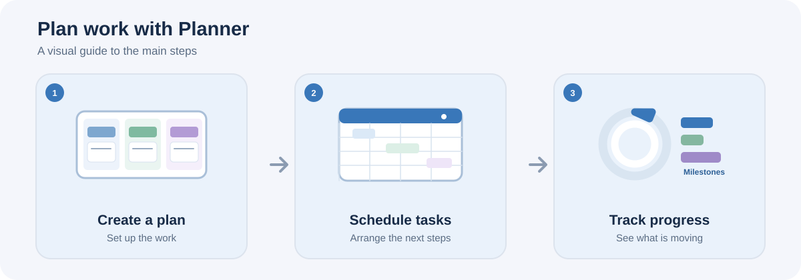

# Brightdesk Planner

{: .product-guide-icon }

{: .product-workflow-diagram }

*Illustrative workflow, not a screenshot of the Brightdesk interface.*

Use Planner to organise a project into a plan, buckets and tasks.

## Create a plan

1. Under **Your plans**, enter a name in **New plan name**.
2. Choose **Create plan**.
3. Select the plan in the left-hand panel.

A new plan starts with a **To do** bucket. Choose **Rename plan** to change the plan name.

## Add a bucket

1. Enter a name in **New bucket name**.
2. Choose **Add bucket**.
3. Repeat for any other task groups you need.

Use the delete control on a bucket only when you intend to remove it. Any tasks in that bucket are moved to another remaining bucket. A plan must keep at least one bucket, so you cannot delete its final bucket.

## Add a task

1. Under **Add a task**, enter a **Task title**.
2. Add a **Description** when you need to explain the task.
3. Choose the **Bucket** for the task.
4. Choose a **Priority**: Low, Normal or High.
5. Choose **Progress**: Not started, In progress or Completed.
6. Add a **Due date** or **Assigned to** value when useful.
7. Choose **Add task**.

## Update and find tasks

- Use the progress selector on a task card to change its progress.
- Choose **Edit** on a task card to change its title.
- Choose **Delete** only when you intend to remove a task.
- Use **Search tasks**, **Filter progress** and **Filter priority** to narrow the board.

## Save your work

Plans, buckets and tasks are saved on this device as you work. Check the local-save status in the workspace.

## Current feature boundaries

Planner currently provides local plans and task boards. Connected user directories, automatic assignment, operating-system notifications, recurring reminders, cloud sync and shared plans are not included in the current stated scope. The current task card editor only exposes title editing and a progress selector.

## Guide status

**Needs review.** These steps are based on the current Planner interface and source. They still need to be run from start to finish in a current installed desktop build before the guide can be approved for customers.

[Back to Brightdesk Help](../index.html)
