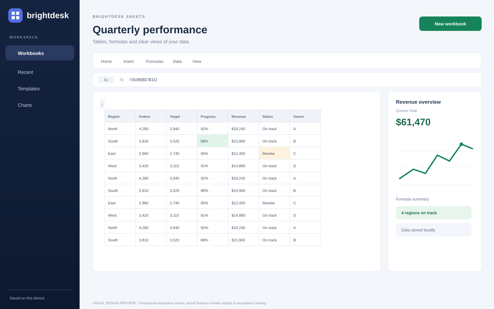
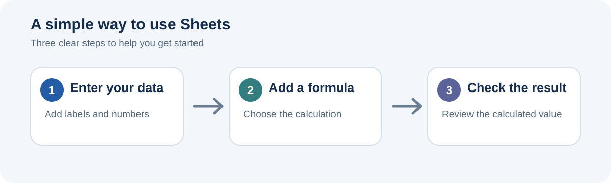

# Brightdesk Sheets

## Overview

Use Sheets to organise information in a grid and calculate values with supported formulas.

<figure class="product-preview">
  
  <figcaption>Design preview only — not a screenshot of the current running product. The actual interface and available controls must be checked against the installed release.</figcaption>
</figure>

<figure class="guide-illustration">
  
  <figcaption>Illustrative workflow map only. It explains the task sequence; it is not a screenshot of the Brightdesk interface.</figcaption>
</figure>
<nav class="guide-contents" aria-label="Sections in this guide">
  <a href="#overview">Overview</a> · <a href="#getting-started">Getting started</a> · <a href="#workflows">Workflows</a> · <a href="#troubleshooting-and-common-questions">Troubleshooting</a>
</nav>

## Getting started

### Enter information

1. Open Brightdesk Sheets. A new spreadsheet opens with the title **Untitled spreadsheet**.
2. Click a cell in the grid, such as **A1**.
3. Type a value into the cell.
4. Press **Enter** to save the value and move down one row.
5. Select the title field to give the spreadsheet a useful name.

## Workflows

### Enter a formula

1. Select the cell where you want the answer to appear.
2. On the **Home** tab, find the selected cell reference (for example, **A1**) beside the formula input.
3. Enter a formula beginning with an equals sign. For example, `=A1+B1` adds two cells.
4. Press **Enter** or move focus away from the formula input to apply the change.
5. Check the calculated value in the grid.

The current calculation engine supports basic arithmetic and these functions: **SUM**, **AVERAGE**, **MIN**, **MAX**, **COUNT** and **COUNTA**. A range formula can look like `=SUM(A1:A5)`.

### Add rows and columns

- On **Home**, choose **+ Row** or **+ Column**.
- You can also open **Insert** and choose **New row** or **New column**.

### Sort information

1. Select a cell in the column you want to sort.
2. Open **Data**.
3. Choose **Sort A → Z** or **Sort Z → A**.
4. Check the grid after the sort.

The sort acts on the sheet rows using the selected column.

### Open, save and export

- Choose **Open** to open a supported workbook or CSV file.
- Choose **Save project** to keep Brightdesk project data on this device.
- Choose **Export** to create an available CSV or XLSX output.

Keep a Brightdesk project copy when you plan to continue editing the workbook.

### Try this example: add up a small budget

1. In cell **A1**, enter **Item**. In **B1**, enter **Cost**.
2. In row 2, enter **Rent** and **1200**.
3. In row 3, enter **Power** and **150**.
4. In row 4, enter **Internet** and **80**.
5. Select **B5**, enter `=SUM(B2:B4)` and press **Enter**.

**What you should have:** a small expense list and a total of **1430** in cell B5.
### More examples to try

#### Work out an average

1. Enter a heading in **A1**, such as **Daily sales**.
2. Enter a few numbers in **A2**, **A3** and **A4**.
3. Select **A5**.
4. Enter `=AVERAGE(A2:A4)` and press **Enter**.
5. Check the result in **A5**.

**What you should have:** the average of the three numbers. Change one of the values to see the result update.

#### Count entries

1. Enter a list of numbers in **B2:B6**.
2. Select **B7** and enter `=COUNT(B2:B6)`.
3. In another cell, enter `=COUNTA(B2:B6)`.
4. Compare the results. **COUNT** counts numeric values; **COUNTA** counts non-empty cells.

**What you should have:** two counts that show the difference between numeric entries and all non-empty entries.

## Troubleshooting and common questions

**Why is my formula showing the wrong result?** Check that it begins with `=`, that the cell references are correct and that the range includes the cells you intended.

**Why is a number not included in a total?** Check that the cell contains a number rather than text, and check the formula range.

**How do I sort a table?** Select a cell in the column you want to use, open **Data**, then choose **Sort A → Z** or **Sort Z → A**. The sort acts on the sheet rows using that column.

## Current feature boundaries

Sheets is a basic spreadsheet foundation. VBA and macros, pivot tables, advanced formula coverage, complex workbook features and exact Excel round-trip compatibility are not promised.

## Guide status

**Needs review.** These steps are based on the current Sheets interface, calculation engine and product documentation. They still need to be run from start to finish in a current installed desktop build before the guide can be approved for customers.

## Need the technical detail?

For product behaviour, file handling and technical boundaries, see the [Brightdesk Sheets technical reference](../technical/products/sheets.html).

[Back to Brightdesk Help](../index.html)
