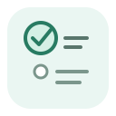
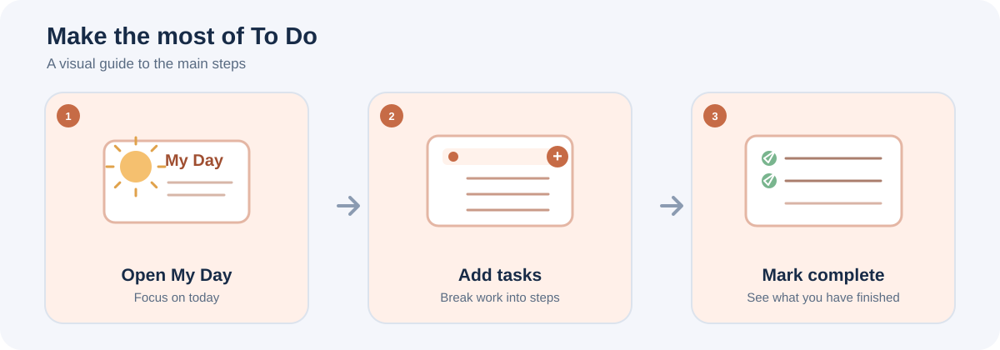

# Brightdesk To Do

{: .product-guide-icon }

  

*Illustrative workflow, not a screenshot of the Brightdesk interface.*

Use To Do to keep track of personal tasks, due dates and priorities.

## Add a task

1. Open the **My Day** view or another task view.
2. Enter a task name in **Add a task**.
3. Choose **Add task**.
4. When you add a task from **My Day**, it is automatically added to that view.

## Add details or edit a task

1. Find the task you want to update.
2. Choose **Edit** on its task card.
3. Change the **Task title**, add **Task notes**, choose a **Due date** or set its **Priority** to Low, Normal or High.
4. Choose **Save**. Choose **Cancel** to close the editor without saving those changes.

## Organise your tasks

- Choose **My Day** to see tasks added to today's list.
- Choose **Important** to see tasks marked as important.
- Choose **Planned** to see tasks that have a due date.
- Choose **Tasks** to see unfinished tasks.
- Choose **Completed** to review finished tasks.
- Use **Search tasks and notes** to find a task.
- Use the star control to **Mark as Important** or **Remove from Important**.
- Use the plus/minus control to **Add to My Day** or **Remove from My Day**.

## Complete or restore a task

Select the checkbox beside a task to mark it complete. Open **Completed** and select the checkbox again to restore it to the unfinished tasks.

Choose **Delete** only when you intend to remove a task.

## Save your work

Your task information is saved on this device as you work. Check the local-save status in the workspace.

## Current feature boundaries

To Do currently supports personal local task lists. Operating-system notifications, recurring reminders, shared task lists, customer accounts and cloud sync are not included in the current stated scope.

## Guide status

**Needs review.** These steps are based on the current To Do interface and source. They still need to be run from start to finish in a current installed desktop build before the guide can be approved for customers.

[Back to Brightdesk Help](../index.html)
