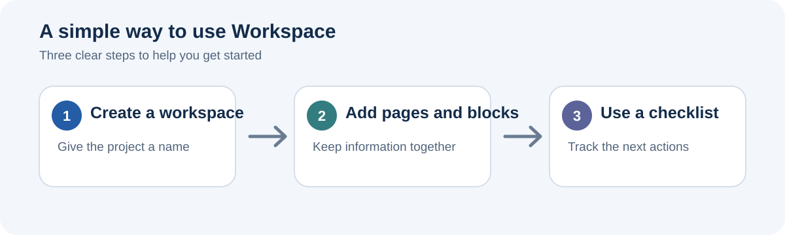

# Brightdesk Workspace

## Overview

Use Workspace to bring related project information together in workspaces and pages.

<figure class="guide-illustration">
  
  <figcaption>Illustrative workflow map only. It explains the task sequence; it is not a screenshot of the Brightdesk interface.</figcaption>
</figure>
<nav class="guide-contents" aria-label="Sections in this guide">
  <a href="#overview">Overview</a> · <a href="#getting-started">Getting started</a> · <a href="#workflows">Workflows</a> · <a href="#troubleshooting-and-common-questions">Troubleshooting</a>
</nav>

## Getting started

### Create a workspace

1. In the left panel, find **Your workspaces**.
2. Choose the **＋** button labelled **Create workspace**.
3. Enter a **Workspace name**.
4. Choose **Create**.

A new workspace includes a **Getting started** page.

## Workflows

### Add a page

1. Under **Pages**, choose the **＋** button labelled **Add page**.
2. Enter a page title in the prompt.
3. The new page appears in the page list. Select it to work on it.

Use **Search pages** to search page titles and page content.

### Add content to a page

1. Open the page you want to edit.
2. Choose a content type from the block list: **Text**, **Heading**, **Bullet list**, **Callout**, **Checklist** or **Divider**.
3. For Text, Heading, Bullet list or Callout, enter the content in the text field.
4. Choose **Add block**.

### Use a checklist

1. Add a **Checklist** block to the page.
2. Enter an item in **Add a checklist item**.
3. Choose **Add item**.
4. Select the checkbox when the item is complete.
5. Edit the item text or use its remove control when needed.

### Organise your page

- Use the **↑** and **↓** controls on a block to move it.
- Choose **Rename page** to change the current page title.
- Choose **Rename workspace** to change the workspace name.
- **Delete page** removes the page and all its content. A workspace must keep at least one page.
- **Delete workspace** removes that workspace and all its pages. At least one workspace must remain.

### Save your work

Workspaces and pages are saved on this device as you work. Check the local-save status in the workspace.

### Try this example: keep a small project together

1. Create a workspace called **Home project**.
2. Rename its starting page **Project notes**.
3. Add a **Heading** block called **Things to do**.
4. Add a **Text** block with a short description.
5. Add a **Checklist** block and enter two items.
6. Tick an item when it is complete.

**What you should have:** one project page with a heading, notes and a checklist. It stays on this device.
### More examples to try

#### Keep a project brief and actions together

1. Create a workspace called **Website refresh**.
2. Rename the starting page **Project brief**.
3. Add a **Heading** block for the project goal.
4. Add a **Text** block with the background and key details.
5. Add a **Checklist** block for the next actions.
6. Use the up and down controls to put the blocks in a useful order.

**What you should have:** one project page with a brief and an action checklist.

#### Organise information across pages

1. Create a workspace called **Home renovation**.
2. Rename the first page **Overview**.
3. Add another page for a separate topic, such as **Materials**.
4. Add Text, Bullet list or Callout blocks to record information.
5. Use **Search pages** to search for a page by its title or content.

**What you should have:** a workspace with separate pages for related information.

## Troubleshooting and common questions

**Can I share a workspace with another person?** The current Workspace scope is local workspaces and pages. Live collaboration and shared workspaces are not included.

**What happens when I delete a page?** The page and all its content are removed. A workspace must keep at least one page.

**Can I delete every workspace?** No. At least one workspace must remain.

## Current feature boundaries

Workspace supports local workspaces and pages with text, heading, bullet, callout, divider and checklist blocks. Live collaboration, shared workspaces, accounts, cloud sync, permissions, external integrations and connected multi-user components are not included in the current stated scope.

## Guide status

**Needs review.** These steps are based on the current Workspace interface and source. They still need to be run from start to finish in a current installed desktop build before the guide can be approved for customers.

## Need the technical detail?

For product behaviour, file handling and technical boundaries, see the [Brightdesk Workspace technical reference](../technical/products/workspace.html).

[Back to Brightdesk Help](../index.html)
