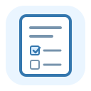

# Forms technical reference

Forms lets customers create local forms and review the responses submitted on the same device.

## Question model

The current question types are:

| Type | Purpose |
| --- | --- |
| Short answer | A short text response |
| Long answer | A longer text response |
| Single choice | One selected option |
| Multiple choice | More than one selected option |
| Date | A date response |

Questions can be marked **Required question**. A required answer is checked when a response is submitted.

Single-choice and multiple-choice questions need between 2 and 30 distinct options. Each submitted choice must match one of the options configured for that question.

## Form areas

The current interface separates form work into three areas:

- **Questions** — configure form details and questions.
- **Preview** — complete the form as a respondent.
- **Responses** — review saved responses.

## Deletion behaviour

Deleting a question also removes that question's answer from every saved response for that form. The other answers in each response remain, but the removed answer cannot be recovered from that form. Review the impact before deleting a question.

## Data boundary

Responses are saved on the device. The current Forms workflow does not publish forms online or provide public response links.

## Related information

- [Data and privacy](../data-and-privacy.html)
- [Everyday Help: Forms](../../products/forms.html)
